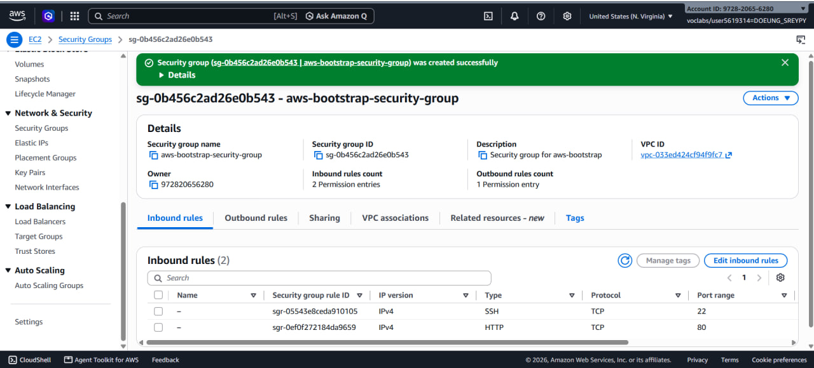
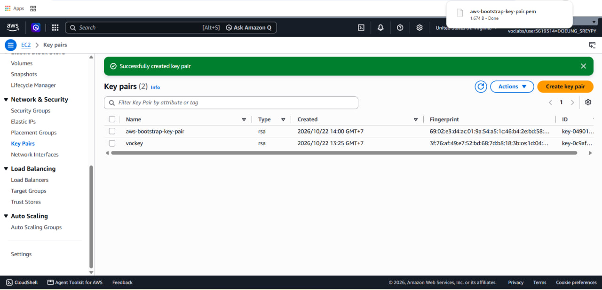
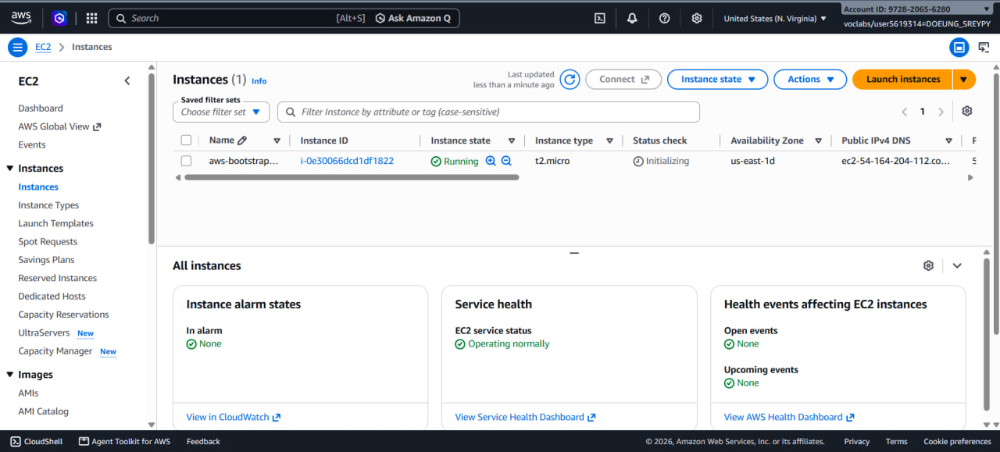
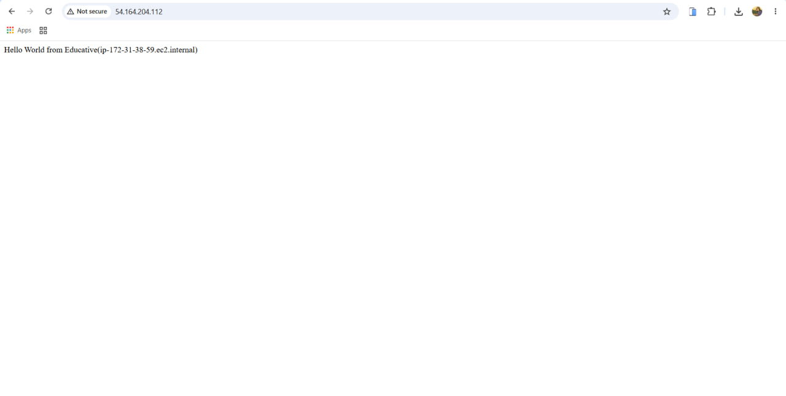
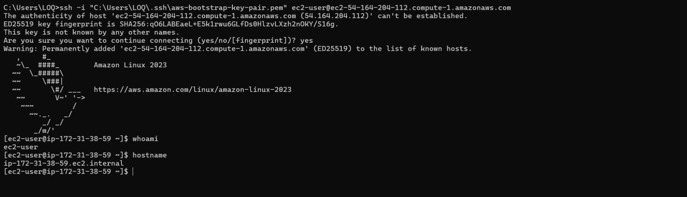
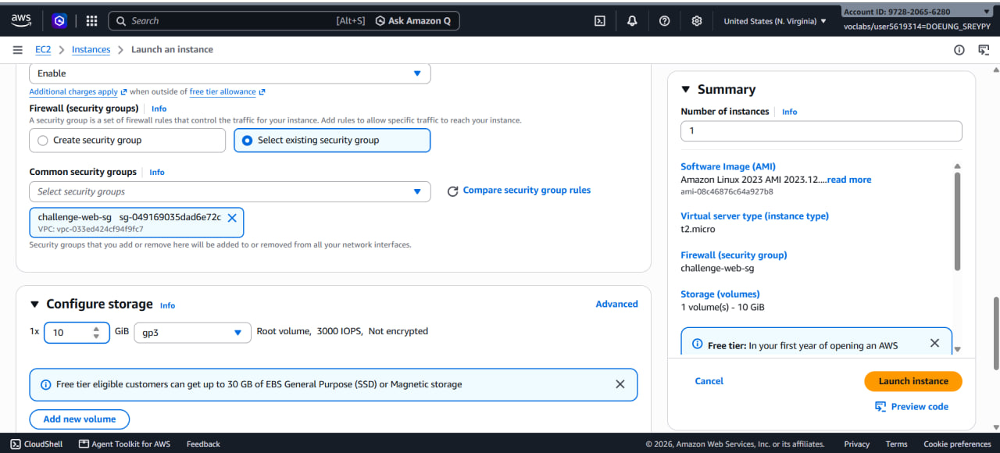
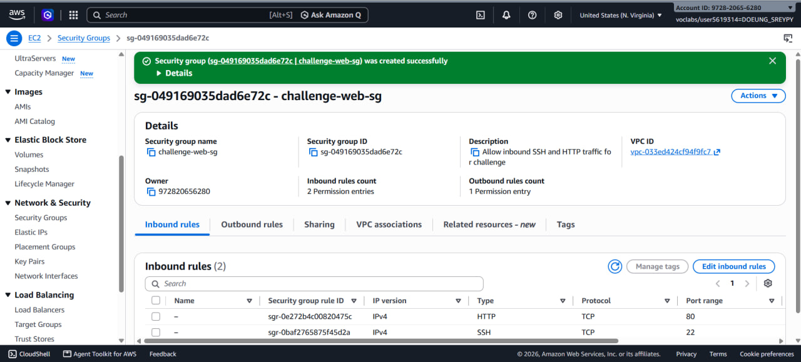
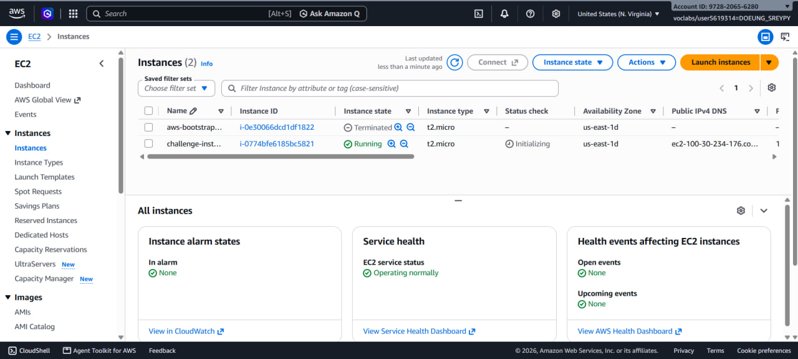
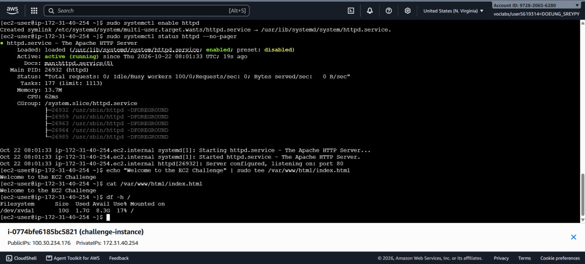

# Lab 1: Amazon EC2 Walkthrough and Web Solution Challenge

**Student ID:** e20220337  
**Region:** us-east-1  

---

## Part 1.1 — Walkthrough: Bootstrapping an EC2 Instance

### 1. Security Group Configuration


### 2. Key Pair Creation


### 3. Instance Details (Running State)


### 4. Browser Verification


### 5. SSH Connection Output


---

## Part 1.2 — Challenge: EC2 Web Solution

### 1. Launch Configuration


### 2. Challenge Security Group


### 3. Running Challenge Instance


### 4. Terminal Commands & Execution


**Commands executed on instance:**
```bash
sudo dnf update -y
sudo dnf install -y httpd
sudo systemctl start httpd
sudo systemctl enable httpd
sudo systemctl status httpd --no-pager
echo "Welcome to the EC2 Challenge" | sudo tee /var/www/html/index.html
cat /var/www/html/index.html
df -h /