# Cloud Lab 2 Submission — Load Balancer and Auto Scaling

- **Student name:** Doeung Sreypy
- **Student ID:** e20220337
- **Learner Lab user name:** DOEUNG_SREYPY
- **Date completed:** October 30, 2026

---

## Security groups

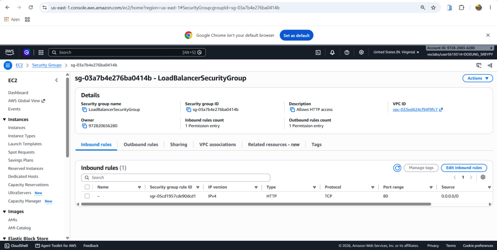

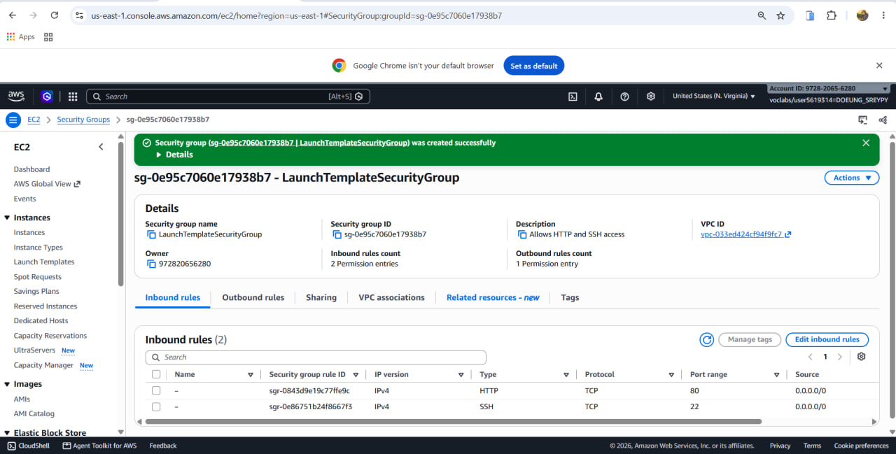

## Target group

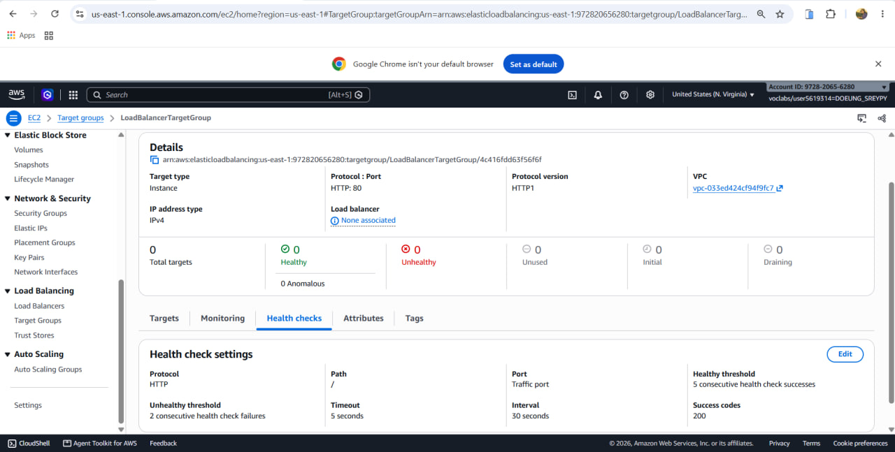

## Application Load Balancer

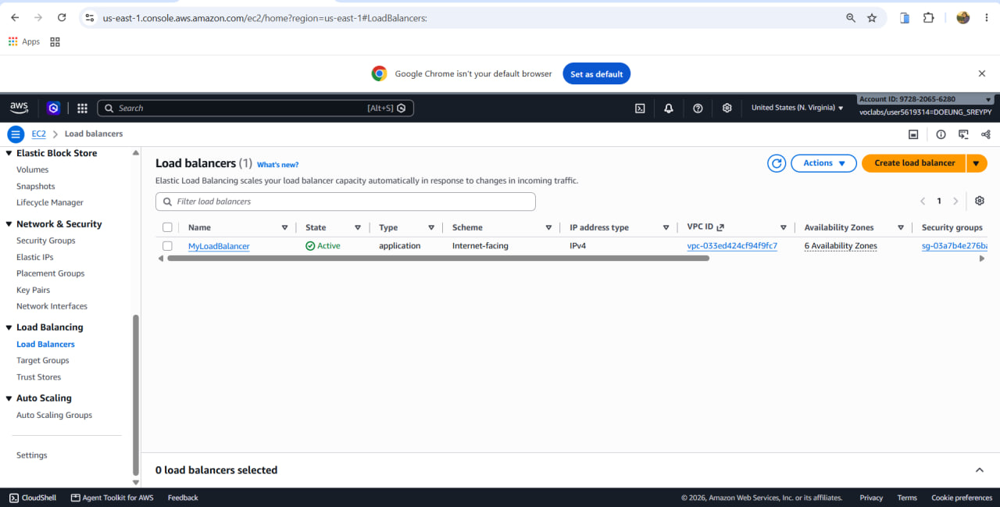

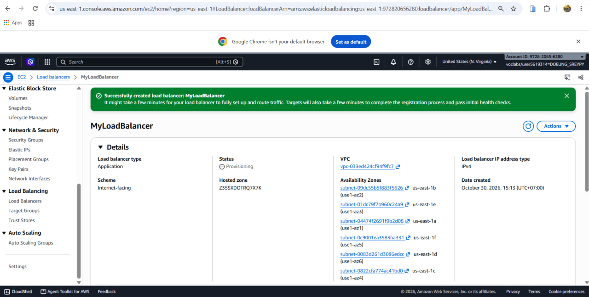

## Launch template

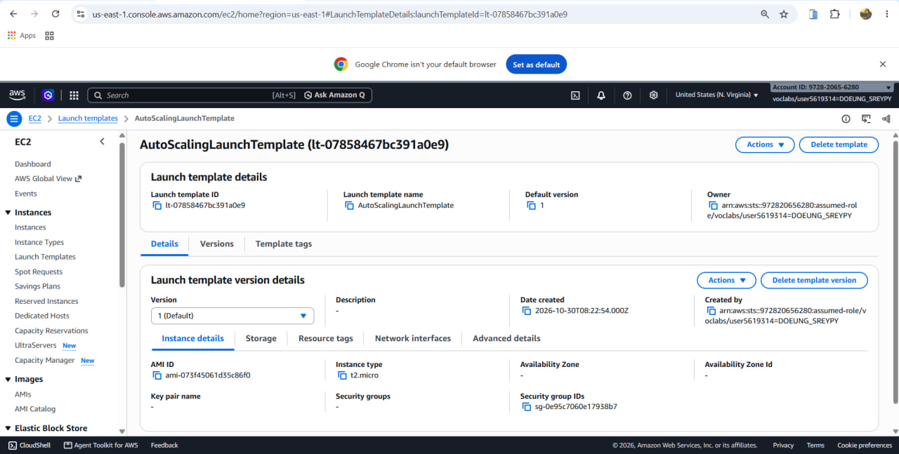

## Auto Scaling group

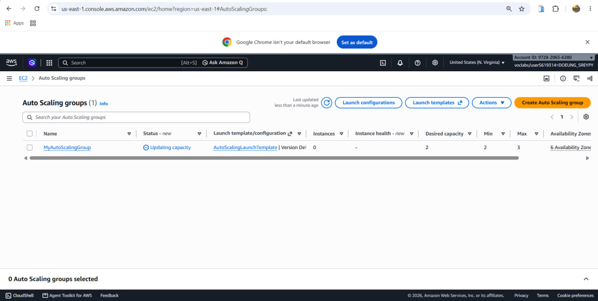

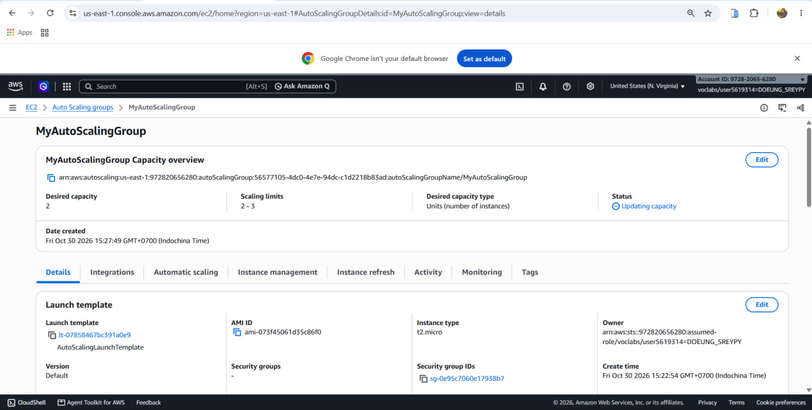

## Load balancing test

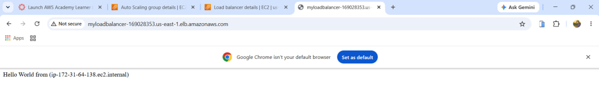

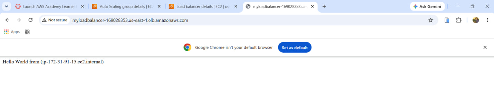

## Simulated application failure

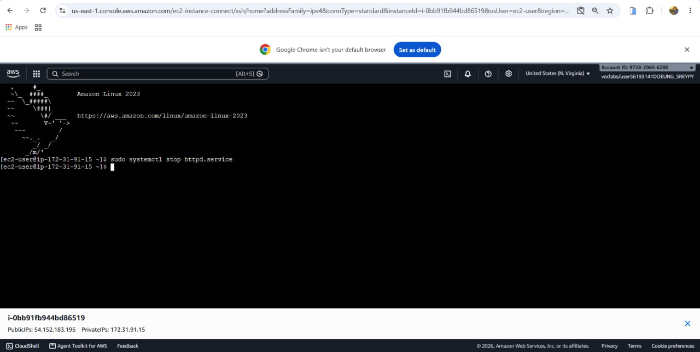

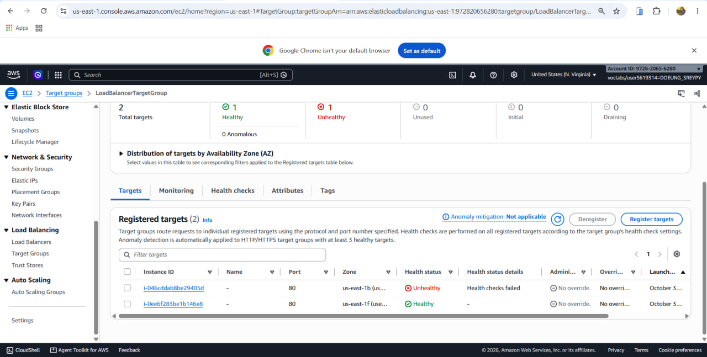

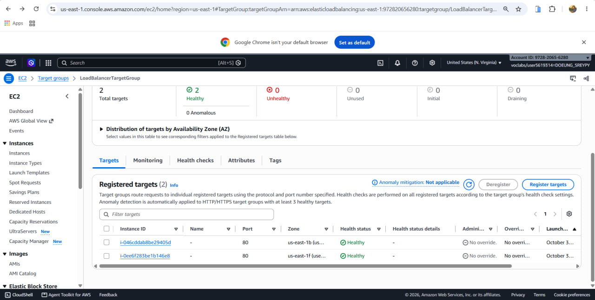

About how many minutes passed between stopping `httpd` and the new instance becoming healthy?  
Approximately 2 to 3 minutes passed (accounting for consecutive failed health check thresholds, ASG detection, instance initialization, bootstrapping via user data, and passing consecutive healthy checks).

---

## Questions

### 1. Why does the page show a different host name when you refresh it?
The Application Load Balancer distributes incoming HTTP requests across all registered, healthy targets in the target group using a round-robin routing algorithm. Since the user data script dynamically prints the host's private hostname (`$(hostname)`) to `index.html`, requests forwarded to different backend EC2 instances return their respective unique hostnames.

### 2. After you stopped `httpd`, the instance was still *running* in EC2, but the target group marked it *unhealthy*. What did the health check test, and why did the instance fail it?
The target group health check sends an HTTP GET request to `/index.html` on port 80 and expects a `200 OK` response code. When `httpd` was stopped, the virtual machine and OS remained operational (so the EC2 instance status checks were green/running), but the web server was no longer listening on port 80. The health check received a connection refused/timeout, failed consecutive threshold checks, and was marked *unhealthy*.

### 3. Who replaced the failed instance: the load balancer, the target group, or the Auto Scaling group? Explain the role of each one.
The **Auto Scaling group** replaced the failed instance. The specific roles of each component are:
- **Load Balancer (ALB):** Receives incoming client traffic, forwards it to healthy targets registered in the target group, and stops routing traffic to any instance that is unhealthy or draining.
- **Target Group:** Continuously performs health checks against instances on port 80 and reports their health status (healthy/unhealthy) to the ALB and ASG.
- **Auto Scaling Group (ASG):** Monitors instance health (using the ELB health check integration). When the target group flags an instance as unhealthy, the ASG terminates the degraded instance and provisions a new replacement instance from the launch template to maintain the desired capacity of 2.

### 4. With desired 2, minimum 2 and maximum 3, how many instances run normally? In what situation could there be 3?
- **Normal state:** 2 instances run normally, as defined by the **desired capacity = 2** and **minimum capacity = 2**.
- **When 3 instances could run:** A 3rd instance runs if a dynamic/target tracking scaling policy triggers due to increased load (e.g., average CPU utilization exceeding a set threshold), or temporarily during an instance replacement/lifecycle roll before the degraded instance is completely terminated.

### 5. The instances' security group allows HTTP from anywhere. How could you change it so that the instances accept HTTP **only** from the load balancer?
In the launch template's security group (`LaunchTemplateSecurityGroup`), edit the Inbound Rule for HTTP (port 80):
- Change the **Source** from `0.0.0.0/0` (Anywhere-IPv4) to the **Security Group ID of the Load Balancer** (e.g., `sg-xxxxxx` / `LoadBalancerSecurityGroup`).
- This restricts traffic so the backend instances only accept HTTP requests originating directly from the ALB, preventing direct public bypass.

---

## Problems and how I solved them (optional)
- **Problem:** When testing the ALB DNS in the web browser, the browser kept forcing an `https://` redirect, resulting in a connection error.
- **Solution:** I explicitly typed `http://` in front of the DNS address or tested using an incognito/private browsing window, since port 443 (SSL/TLS) was not configured on the listener.

---

## AI note (optional)
- **One suggestion an AI tool gave you and how you checked it:** The AI suggested referencing the Security Group ID of the ALB as the source in the EC2 instance security group to enforce least-privilege traffic flow.
- **How I checked it:** In the AWS VPC/EC2 console under Inbound Rules, I typed the security group ID (`sg-...`) into the Source field, confirmed that AWS auto-completed the reference, and verified that direct public IP requests were blocked while traffic through the ALB DNS continued to load.

---

## Clean up

- [x] `MyAutoScalingGroup` deleted and its instances terminated.
- [x] `AutoScalingLaunchTemplate` deleted.
- [x] `MyLoadBalancer` and `LoadBalancerTargetGroup` deleted.
- [x] Both security groups deleted.