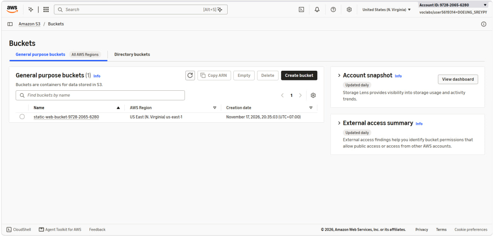
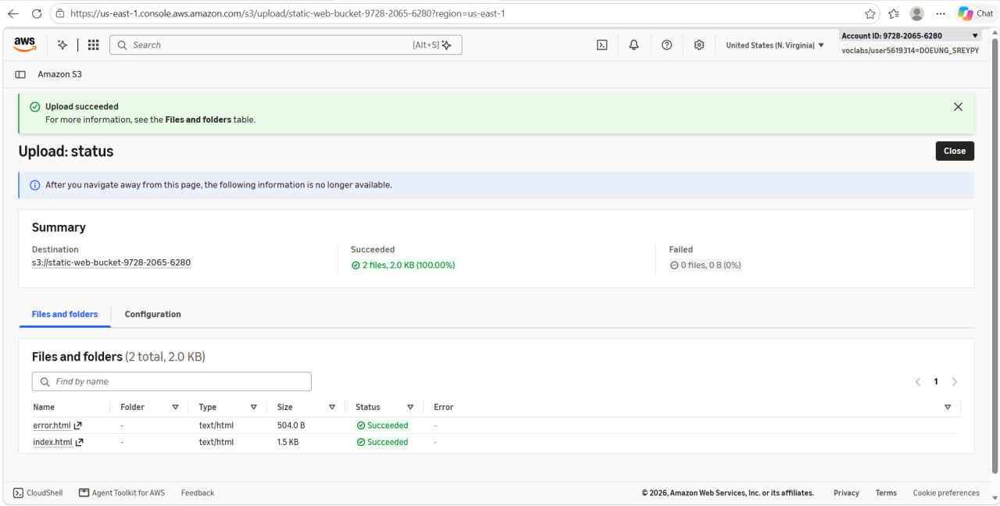
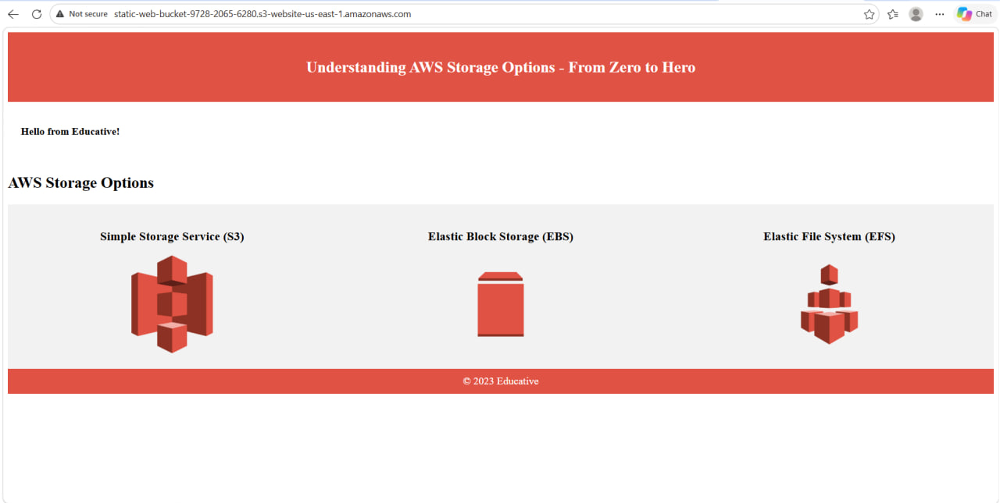
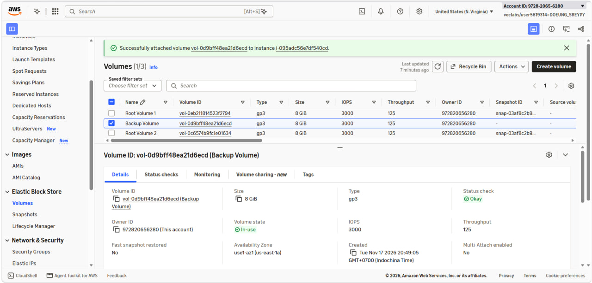
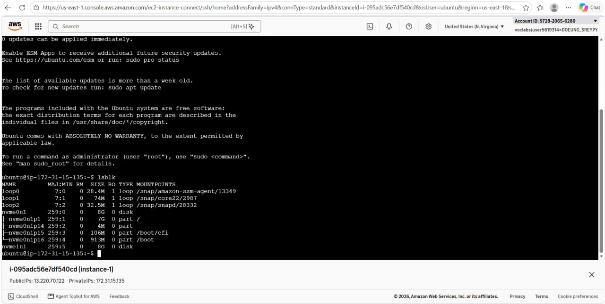
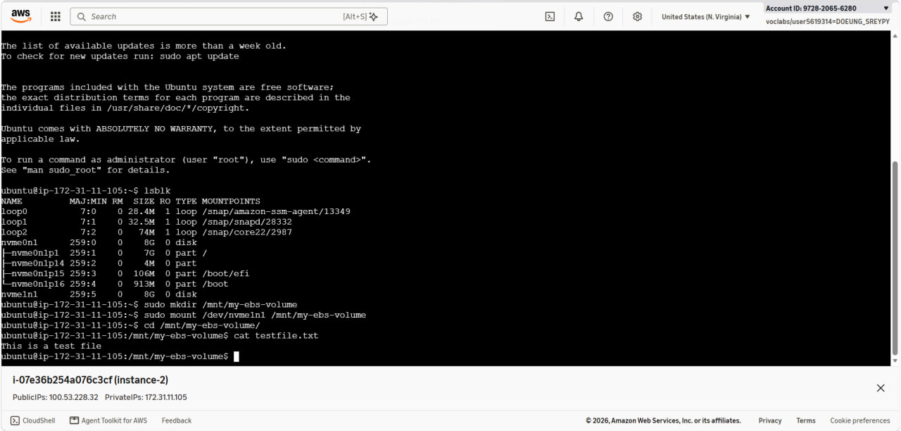
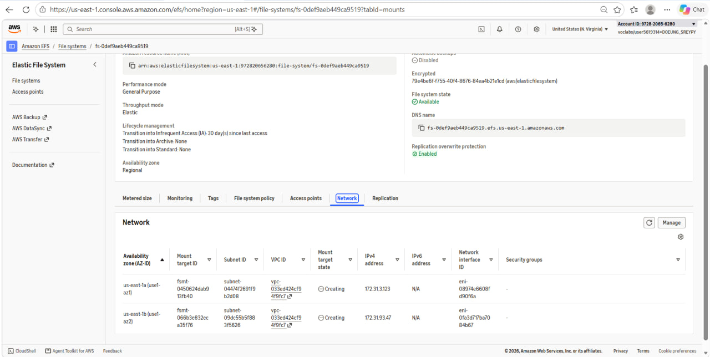
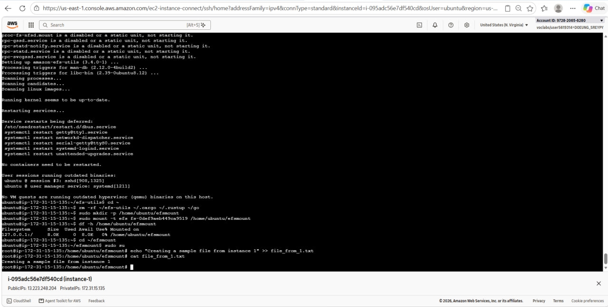
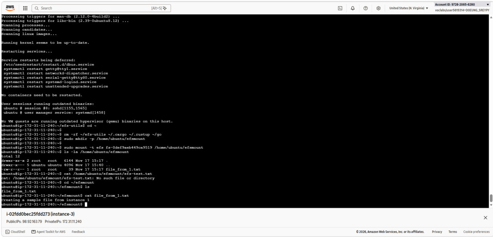

# Cloud Lab 3 Submission — AWS Storage Options

- **Student name:** Doeung Sreypy
- **Student ID:** e20220337
- **Learner Lab user name:** DOEUNG_SREYPY
- **Date completed:** November 17, 2026

---

## Part 2.1 — Amazon S3

### Bucket list

### Uploaded files

### Static website

---

## Part 2.2 — Amazon EBS

### Volumes page

### Attached volume (`lsblk`)

Which device name did your volume get (`xvdf`, `nvme1n1`, ...)?
- The volume was exposed as **`nvme1n1`** (`/dev/nvme1n1`)[cite: 81].

### File read on instance-2

---

## Part 2.3 — Amazon EFS

### File system and mount targets

### File created on instance-1

### File listed on instance-3

---

## Questions

### 1. After you turned on static website hosting, the endpoint first answered **403 Forbidden**. Why, and what changed after you added the bucket policy?

* **Why it answered 403 Forbidden:** By default, Amazon S3 buckets and all objects inside them are **private**, and **Block Public Access** is enabled. Even when static website hosting is turned on, S3 denies anonymous public read requests (`s3:GetObject`) unless explicitly permitted.
* **What changed after adding the bucket policy:** Disabling Block Public Access and attaching a resource-based bucket policy granting `s3:GetObject` to Principal `"*"` (everyone) explicitly allowed anonymous internet users to read and download the HTML/asset files from the static website endpoint.

---

### 2. `testfile.txt` was still there after you moved **Backup Volume** to `instance-2`. What would have happened to a file saved on `instance-1`'s **root** volume after terminating `instance-1`?

* The file saved on `instance-1`'s root volume would have been **permanently deleted**.
* By default, an EC2 instance's root EBS volume has the **`DeleteOnTermination`** attribute enabled, meaning AWS automatically deletes the root volume when the instance is terminated. In contrast, secondary EBS volumes (`Backup Volume`) have `DeleteOnTermination` disabled by default, allowing them to persist independently of the instance lifecycle and be reattached elsewhere.

---

### 3. Why did you run `mkfs` on `instance-1` but not on `instance-2`?

* **`instance-1`:** A newly created EBS volume is raw, unformatted block storage with no file system. Running `sudo mkfs -t ext4 /dev/nvme1n1` created an `ext4` file system structure so the OS could mount and write files to it.
* **`instance-2`:** The volume already contained the `ext4` file system and `testfile.txt` created on `instance-1`. Running `mkfs` again on `instance-2` would have **reformatted the volume and wiped out all existing data**. It only needed to be mounted (`sudo mount`).

---

### 4. Why could `instance-1` and `instance-3` use the EFS file system at the same time, when an EBS volume had to be detached first? Why did they have to be in the subnets of the mount targets?

* **Simultaneous access (EFS vs. EBS):**
  * **Amazon EFS** is a managed network file system (using the NFSv4 protocol) designed for concurrent multi-instance access across multiple Availability Zones, handling file locking and distributed consistency automatically.
  * **Amazon EBS** is network-attached block storage tied to a single Availability Zone and designed to attach to one EC2 instance at a time (standard volumes do not support multi-attach without specialized cluster-aware file systems, as simultaneous raw block writes would corrupt data).
* **Subnet mount targets:**
  * EFS mount targets expose an NFS endpoint with a private IP address inside each specified VPC subnet. An EC2 instance needs to be in a subnet with an active mount target (or able to route to one within the VPC) so it can resolve the mount target's local network interface and communicate over port `2049` (NFS).

---

### 5. For each need, choose S3, EBS or EFS and give one reason: (a) a website's images, (b) the disk of a database server, (c) a folder shared by several web servers.

* **(a) A website's images — Amazon S3:** Object storage provides unlimited scalability, 99.999999999% (11 nines) durability, and direct HTTP/HTTPS delivery over the web (and via CloudFront) without needing to attach disks to a server.
* **(b) The disk of a database server — Amazon EBS:** Block storage delivers low-latency, high-IOPS persistent disk performance directly attached to a single database host, which is required for transactional database reads/writes.
* **(c) A folder shared by several web servers — Amazon EFS:** Shared network file storage allows multiple EC2 web servers across different Availability Zones to concurrently read and write to a single centralized directory using standard file system semantics.

---

## Problems and how I solved them (optional)

* **Issue:** The lab instructions referenced device name `/dev/xvdf`, which did not appear when running `lsblk` on Ubuntu.
* **Solution:** Inspected `lsblk` output and identified that Nitro-based EC2 instances expose EBS volumes as NVMe devices (`nvme1n1`)[cite: 81]. Formatted and mounted `/dev/nvme1n1` instead, which worked immediately.

---

## AI note (optional)

* **Suggestion:** When `/dev/xvdf` was not found, an AI assistant identified that modern AWS EC2 instance types use NVMe drivers and pointed out `nvme1n1` from my `lsblk` screenshot[cite: 81].
* **Verification:** Verified the 8 GB disk size and empty partition table of `nvme1n1` in `lsblk` before running `sudo mkfs -t ext4 /dev/nvme1n1` and confirming the mount with `df -h`[cite: 81].

---

## Clean up

- [x] Instances `instance-1`, `instance-2`, `instance-3` terminated.
- [x] `clab-efs` and **Backup Volume** deleted.
- [x] Security groups `efs-sg` and `ec2instances-sg` deleted.
- [x] S3 bucket emptied and deleted.