# Cloud Lab 4 Submission — Amazon VPC

- **Student name:** Doeung Sreypy
- **Student ID:** e20220337
- **Learner Lab user name:** DOEUNG_SREYPY
- **Date completed:** November 11, 2026

---

## VPC and internet gateway

Created a custom VPC (`lab4-vpc`) with CIDR block `10.0.0.0/24` and provisioned an Internet Gateway (`lab4-igw`) attached directly to the VPC.

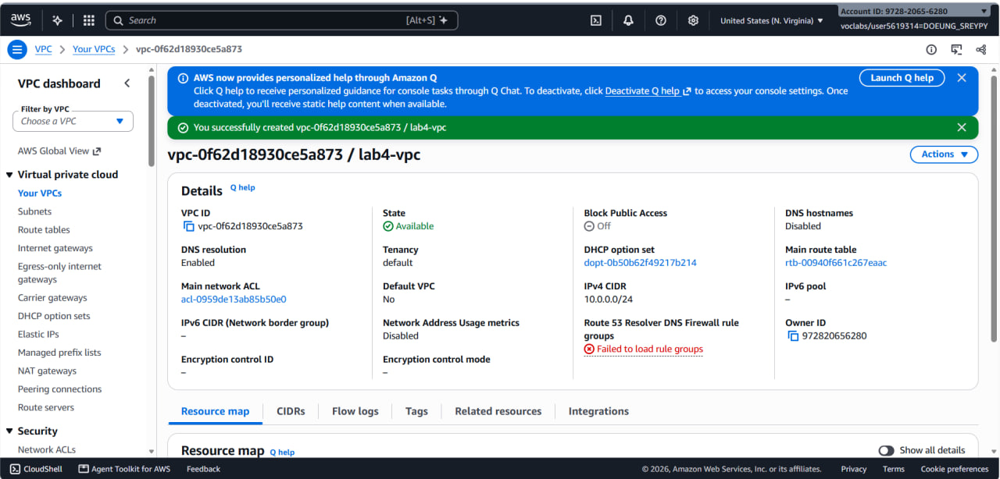
*Figure 1: Custom VPC creation and CIDR block configuration.*

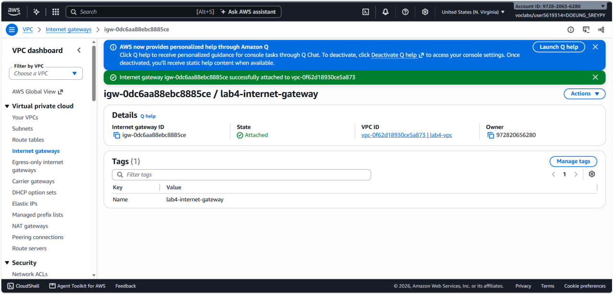
*Figure 2: Internet Gateway created and attached to the VPC.*

---

## Public subnet

Provisioned `lab4-public-subnet` (`10.0.0.0/25`), created a custom route table with a default route (`0.0.0.0/0`) targeting the Internet Gateway, and launched `lab4-ec2-01` inside it.

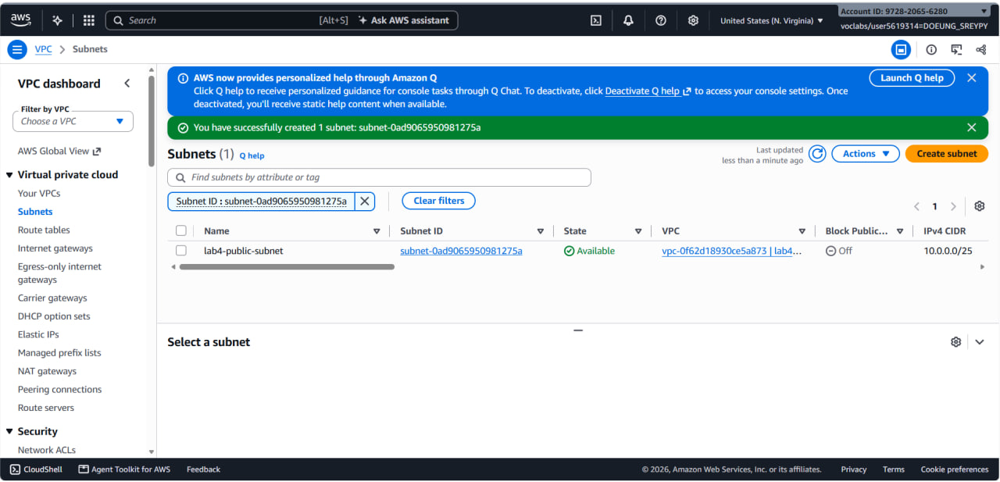
*Figure 3: Public subnet configuration.*

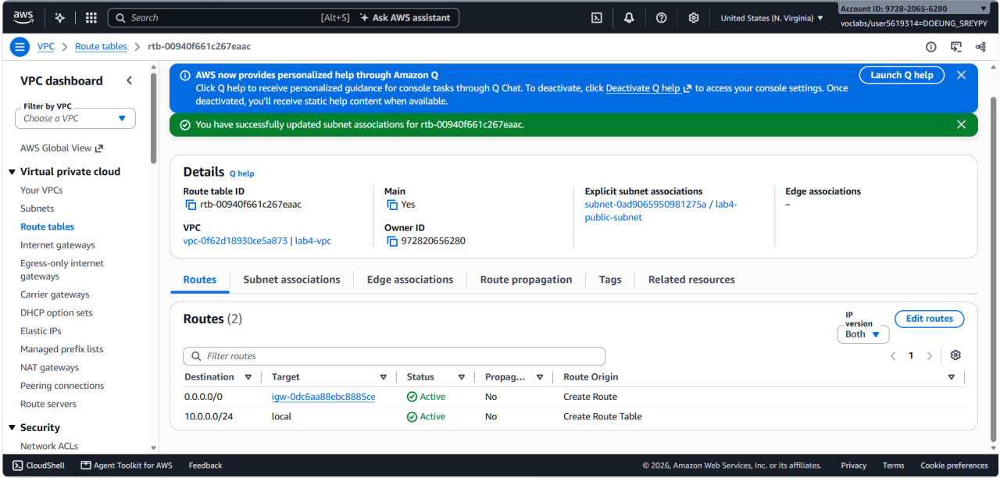
*Figure 4: Public route table associated with the public subnet pointing default route to the IGW.*

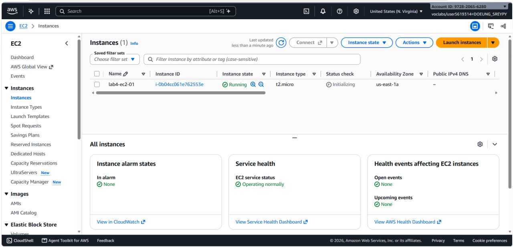
*Figure 5: EC2 instance running in the public subnet with an auto-assigned public IP address.*

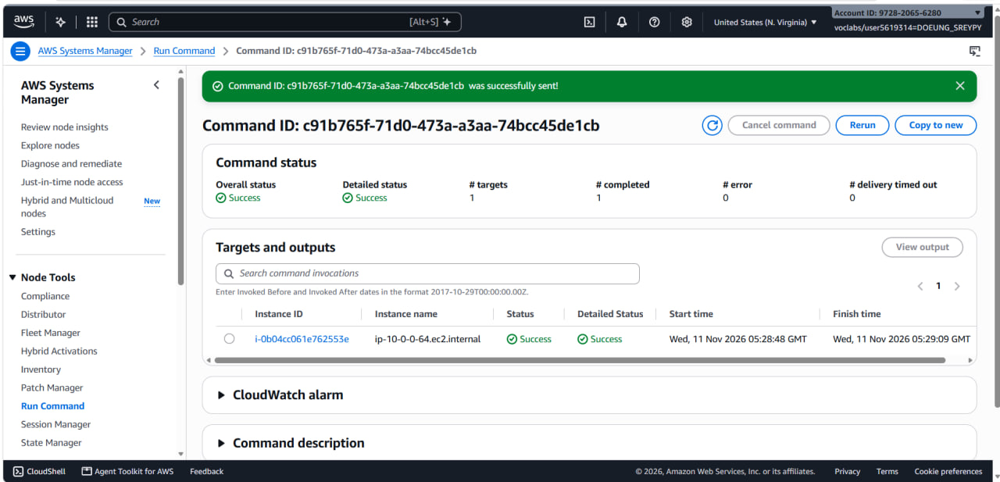
*Figure 6: Connectivity test verifying outbound internet access from the public instance.*

---

## Private subnet

Created `lab4-private-subnet` (`10.0.0.128/25`), deployed a NAT Gateway in the public subnet with an Elastic IP, configured a private route table sending outbound egress (`0.0.0.0/0`) through the NAT Gateway, and launched `lab4-ec2-02`.

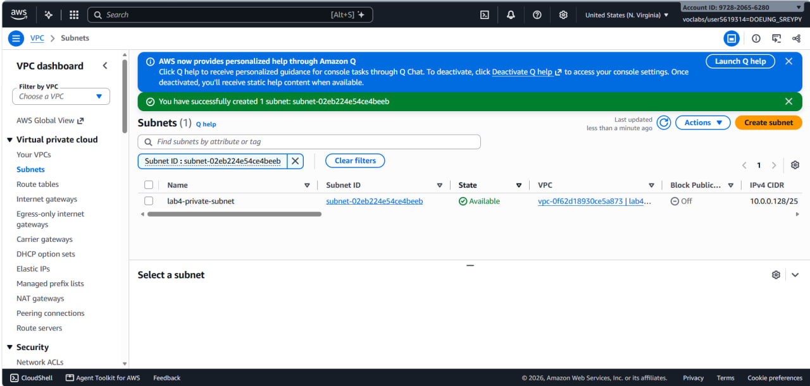
*Figure 7: Private subnet configuration.*

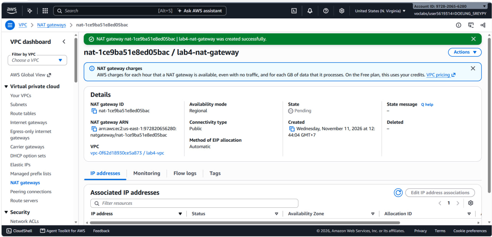
*Figure 8: NAT Gateway deployed in the public subnet with an allocated Elastic IP.*

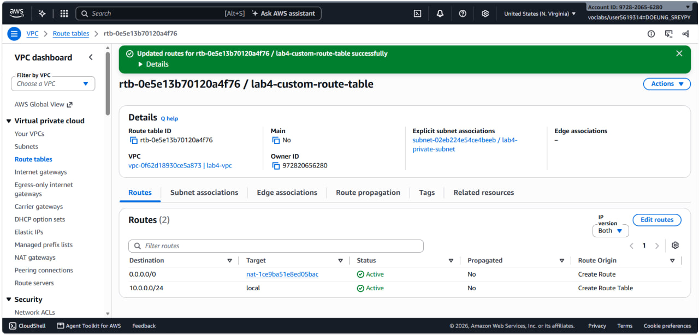
*Figure 9: Private route table associated with the private subnet routing 0.0.0.0/0 to the NAT Gateway.*

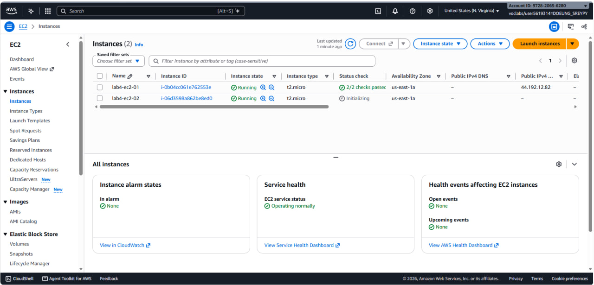
*Figure 10: Private EC2 instance running without a public IP address.*

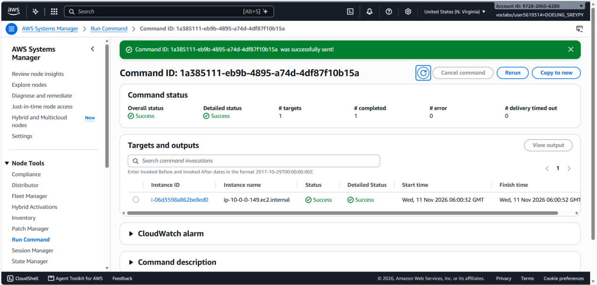
*Figure 11: Connectivity test verifying the private EC2 instance can reach the internet via the NAT Gateway.*

---

## Questions

#### 1. The VPC is 10.0.0.0/24 and the subnets are 10.0.0.0/25 and 10.0.0.128/25. How many IP addresses does each block contain, and why do the two subnets not overlap?

* **Total IP addresses per block**:
  * **VPC (`10.0.0.0/24`)**: Contains $2^{(32 - 24)} = 2^8 =$ **256 IP addresses** (range: `10.0.0.0` to `10.0.0.255`).
  * **Subnet 1 (`10.0.0.0/25`)**: Contains $2^{(32 - 25)} = 2^7 =$ **128 IP addresses** (range: `10.0.0.0` to `10.0.0.127`). AWS reserves 5 addresses, leaving 123 usable host IPs.
  * **Subnet 2 (`10.0.0.128/25`)**: Contains $2^{(32 - 25)} = 2^7 =$ **128 IP addresses** (range: `10.0.0.128` to `10.0.0.255`). AWS reserves 5 addresses, leaving 123 usable host IPs.
* **Why they do not overlap**:
  * In binary representation, a `/25` netmask fixes the first 25 bits. The 25th bit (the most significant bit of the fourth octet) splits the `/24` block into two distinct halves:
    * `10.0.0.0/25` has the 25th bit set to `0` (covering binary values `00000000` to `01111111`, decimal 0–127).
    * `10.0.0.128/25` has the 25th bit set to `1` (covering binary values `10000000` to `11111111`, decimal 128–255).
  * Because the 25th bit is mutually exclusive between the two subnets, their address ranges are entirely disjoint and share no addresses.

---

#### 2. Both subnets are in the same VPC. What exactly makes lab4-public-subnet public and lab4-private-subnet private?

What defines a subnet as public or private is **how its associated route table routes external internet traffic**:
* **`lab4-public-subnet` is public** because its associated route table has a default route (`0.0.0.0/0`) pointing directly to an **Internet Gateway (IGW)** target (`igw-xxxx`). Instances launched here can receive direct inbound traffic from the internet if they have a public IP.
* **`lab4-private-subnet` is private** because its route table has **no route to an Internet Gateway**. Its default outbound route (`0.0.0.0/0`) points either to a **NAT Gateway** (`nat-xxxx`) or remains purely local (`10.0.0.0/24` -> `local`). This configuration makes instances inside it directly unreachable from the public internet.

---

#### 3. Why is the NAT gateway placed in the public subnet and not in the private one?

* A NAT Gateway translates private IP addresses to a public Elastic IP (EIP) so private instances can access the external internet.
* For the NAT Gateway itself to send translated packets to the internet and receive return traffic, **it must have a direct route to an Internet Gateway (IGW)**.
* Only the **public subnet** has a route table that routes traffic (`0.0.0.0/0`) out through the Internet Gateway. If the NAT Gateway were deployed inside the private subnet, its own outbound packets would have no path to reach the internet, rendering it unable to function.

---

#### 4. lab4-ec2-02 has no public IP address. Can someone on the internet open a connection to it? Can it download updates? Explain both answers.

* **Can someone on the internet open a connection to it?**
  * **No.** Because `lab4-ec2-02` lacks a public IP address, it is not routable or addressable over the public internet. Furthermore, the private subnet lacks an Internet Gateway route, and the NAT Gateway only handles egress translation (it does not accept unsolicited inbound connection attempts from external internet hosts).
* **Can it download updates?**
  * **Yes.** Because the private subnet's route table directs default outbound traffic (`0.0.0.0/0`) to the NAT Gateway in the public subnet, `lab4-ec2-02` can initiate outbound connections (such as HTTP/HTTPS requests to OS package repositories). The NAT Gateway masks the private IP using its Elastic IP, completes the handshake with the external server, and routes the response back to `lab4-ec2-02`.

---

#### 5. You tested internet access with Systems Manager instead of SSH. Why did the instances need LabInstanceProfile for this?

* AWS Systems Manager (SSM) Session Manager connects to EC2 instances using the **SSM Agent** running inside the guest operating system rather than an open inbound SSH port (port 22).
* For the SSM Agent to register with the Systems Manager service endpoint, poll for instructions, and establish the encrypted control channel, the instance must make authenticated API calls to AWS SSM endpoints.
* Attaching the IAM role **`LabInstanceProfile`** grants the instance temporary security credentials containing the required managed permissions (specifically policies equivalent to `AmazonSSMManagedInstanceCore`), allowing the SSM Agent to securely communicate with the Systems Manager service without storing hardcoded access keys.

---

### Clean up

- [x] Instances terminated (`lab4-ec2-01`, `lab4-ec2-02`).
- [x] NAT gateway deleted and its associated Elastic IP released.
- [x] Internet gateway detached from `lab4-vpc` and deleted.
- [x] `lab4-vpc` deleted (along with its subnets and route tables).