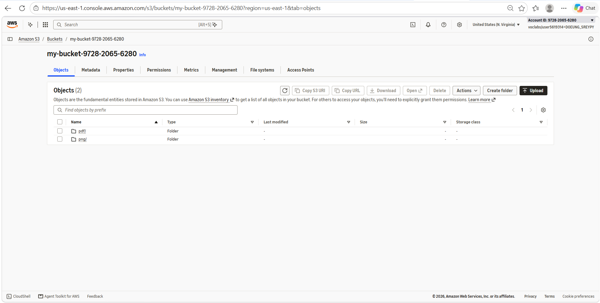
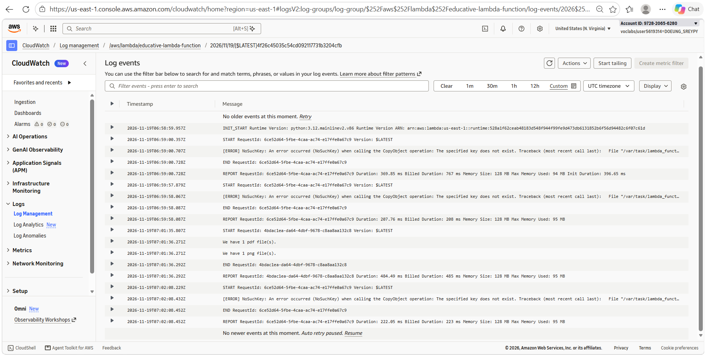

# Cloud Lab 6 Submission — S3 Events with AWS Lambda

- **Student name:** DOEUNG SREYPY
- **Student ID:** e20220337
- **Learner Lab user name:** voclabs/user5619314=DOEUNG_SREYPY
- **Bucket name:** my-bucket-9728-2065-6280
- **Date completed:** November 19, 2026

---

## Files sorted by type

I uploaded `Mentor_Question.pdf` and a `.png` file. The Lambda function automatically created the `pdf/` and `png/` folders based on each file's extension and moved the uploaded files into their corresponding folders.

## CloudWatch logs

## Function code

My function code is in [lambda_function.py](lambda_function.py).

---

## Questions

1. **Describe, step by step, what happens from the moment you click Upload until the log line appears in CloudWatch. Name each AWS service involved.**
   - **Amazon S3:** When I click **Upload**, S3 stores the uploaded file in the bucket (`my-bucket-9728-2065-6280`) as a `PUT` object creation event.
   - **Amazon S3 Event Notification / Trigger:** S3 detects the `s3:ObjectCreated:Put` event and asynchronously invokes the configured **AWS Lambda** function (`educative-lambda-function`), passing the bucket name and object key in the JSON event payload.
   - **AWS IAM (`LabRole`):** AWS Lambda assumes `LabRole` to obtain temporary permissions to interact with S3 and CloudWatch.
   - **AWS Lambda & Amazon S3:** The Python function extracts the file extension, calls S3 `copy_object` to copy the file into `<extension>/<filename>`, calls `delete_object` to remove the original root file, and lists all folders to count the files of each type.
   - **Amazon CloudWatch Logs:** When the Python code executes `print('We have {} {} file(s).'.format(...))`, the Lambda runtime automatically streams the standard output and execution metrics to the `/aws/lambda/educative-lambda-function` log group in **CloudWatch Logs**.

2. **Why was the trigger limited to PUT events? What would happen with All object create events?**
   - Uploading a file through the console triggers a `PUT` event, whereas the function's `s3.copy_object()` call triggers a `Copy` event. Limiting the trigger to **PUT** ensures that only external file uploads invoke the function, ignoring the internal copy performed by the function itself.
   - If **All object create events** (`s3:ObjectCreated:*`) were selected, the `copy_object` operation inside the function would trigger a new Lambda invocation. On that second run, the function would attempt to copy the already-moved file onto itself (which S3 rejects, causing errors and Lambda retries) or, if writing new keys, create a costly recursive infinite loop.

3. **The function uses `LabRole`. Which two permissions does this role need for the function to work?**
   - **Amazon S3 permissions** (such as `s3:GetObject`, `s3:PutObject`, `s3:DeleteObject`, and `s3:ListBucket`) so the function can read, copy, delete, and list objects inside the bucket.
   - **Amazon CloudWatch Logs permissions** (`logs:CreateLogGroup`, `logs:CreateLogStream`, and `logs:PutLogEvents`) so Lambda can create log streams and write `print()` output to CloudWatch.

4. **You never started or stopped a server in this lab. Who runs your code, and what do you pay for?**
   - **AWS Lambda** (managed by AWS) provisions, runs, scales, and maintains the underlying compute infrastructure automatically in a serverless model.
   - You only pay for actual usage based on two metrics: the **number of requests** (invocations) and the **execution duration** (measured in GB-seconds, determined by the memory allocated and how long the code runs)—you pay nothing when the function is idle.

## Clean up

- [x] Lambda function deleted.
- [x] S3 bucket emptied and deleted.